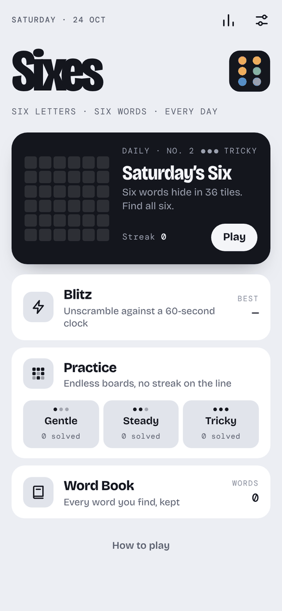
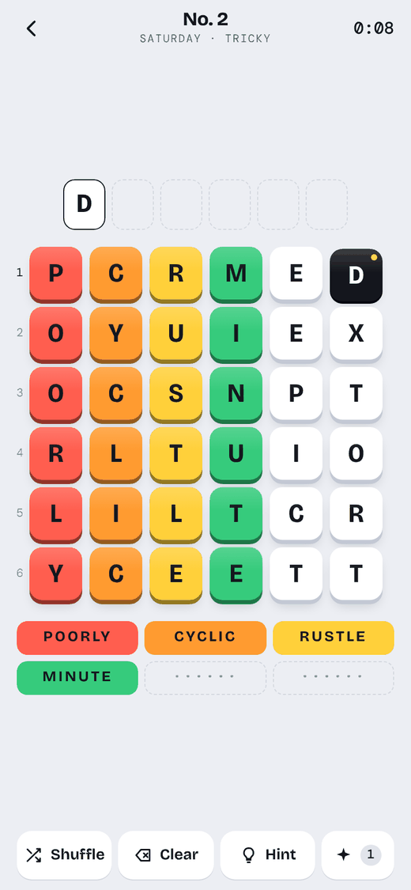
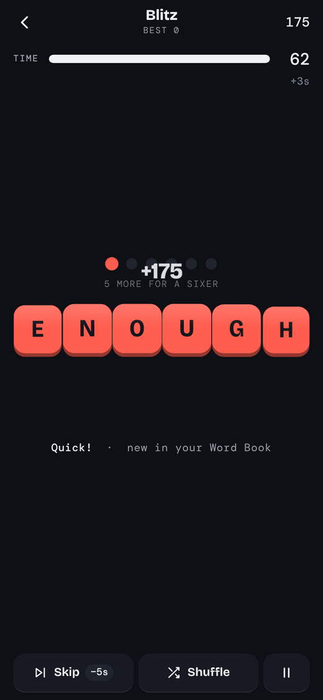

# Sixes

A word game where everything comes in sixes. Each day's board is 36 letter tiles hiding six six-letter words. Find all six.

**Play:** https://sixes.jeremyfelt.com

<p>
  
  
  
</p>

## How to play

**Daily.** The board has six rows. Each row holds one letter from every hidden word: row 1 holds the six first letters, row 6 the six last letters. Tap one tile in each row to spell a word from top to bottom.

- A word that belongs to the board locks into a column and takes a color.
- A real word that doesn't belong is a bonus word. It goes in your Word Book.
- Stuck? Shuffle the rows, or take a hint. Each hint reveals the next letter of one word.
- When five words are found, the sixth fills itself in.

A new board arrives at midnight, local time. Solve it each day to build a streak. Boards are Gentle early in the week, Steady midweek and Sunday, and Tricky on Friday and Saturday.

**Blitz.** Unscramble six-letter words against a 60-second clock. Each solve adds 3 seconds and a skip costs 5. Six solves in a row is a Sixer: 600 bonus points and 6 more seconds.

**Practice.** 500 boards at each difficulty, with no streak on the line.

**Word Book.** Every word you find in any mode, sorted A to Z. Tap a word to look it up.

Progress, streaks and stats are stored on the device. There are no accounts and no tracking.

## Put it on your iPhone

1. Open https://sixes.jeremyfelt.com in Safari.
2. Tap Share, then **Add to Home Screen**.

Sixes opens full screen with its own icon, works offline, and keeps your progress on the phone. Progress in Safari and in the Home Screen app is stored separately, so add it to the Home Screen before you start a streak.

## Hosting

`docs/` is the complete, built app. GitHub Pages serves it from **Settings → Pages → Build and deployment → Deploy from a branch → `main` / `docs`**, at the custom domain in `docs/CNAME`. The build never touches that file. Any static host works too: upload the contents of `docs/` and serve them over HTTPS.

To try it locally, run `python3 -m http.server 8000 --directory docs` and open http://localhost:8000.

## Project layout

| Path | What it holds |
| --- | --- |
| `src/` | The game: `app.html` (markup), `app.css` (styles), `app.js` (game logic) |
| `data/valid.txt` | Every six-letter word the game accepts (15,551) |
| `data/common.txt` | Everyday words used for hints, checking boards and anagram tips (7,490) |
| `data/answers.txt` | Words that can be hidden on a board, most common first (2,638) |
| `data/puzzles.json` | The daily calendar (1,100 days from 23 Oct 2026) and 1,500 practice boards |
| `assets/fonts/` | Bricolage Grotesque and DM Mono, built into the page so the app works offline |
| `scripts/` | Build scripts and the end-to-end test |
| `docs/` | The built app that gets served. Generated, so don't edit it by hand |

## Building

You need Python 3.9 or newer.

```sh
pip install -r requirements.txt
python3 scripts/build.py
```

`build.py` combines `src/`, `data/` and the fonts into `docs/index.html`, writes the manifest, icons and offline service worker, and gives the cache a new version so installed copies pick up the change. Commit `docs/` along with your source changes.

### Changing words and puzzles

- **Accept a missing word:** add it to `data/valid.txt`, then rebuild. To keep it when the word lists are regenerated, also add it to `EXTRA_VALID` in `scripts/build_words.py`.
- **Regenerate the word lists from their sources:** run `npm install`, then `python3 scripts/build_words.py`. The filters at the top of that script control which words are blocked and which can never be answers.
- **Extend the calendar:** raise `DAYS` in `scripts/gen_puzzles.py` and run it. The generator is seeded, so every existing day stays the same. The current calendar runs through 26 Oct 2029. After that, the app draws daily boards from the practice set.

Regenerating puzzles after changing `answers.txt` or the generator's settings rewrites days people may already have played. Boards are checked so their 36 tiles split into six common words in only one way (Gentle) or at most two ways (Steady and Tricky).

## Testing

```sh
python3 -m playwright install chromium
python3 scripts/test_e2e.py
```

The test plays the built app in headless Chromium at phone sizes: the daily board from first tap to results, practice, a Blitz run with a Sixer, leaving Blitz from every screen, the Word Book, stats, closing panels with the X and by swiping, a small-screen layout and the landscape note. It also recreates how iPhone Safari layers scrolling areas, so a control buried under one fails the test. Screenshots land in `test-results/`.

## Credits

- [ENABLE](https://github.com/dolph/dictionary) word list, public domain.
- [SCOWL](http://wordlist.aspell.net/) by Kevin Atkinson and contributors, through the [wordlist-english](https://www.npmjs.com/package/wordlist-english) package. Copyright and permission notice in `data/SCOWL-copyright.txt`.
- Word frequencies from [wordfreq](https://github.com/rspeer/wordfreq) by Robyn Speer. Its data is licensed CC BY-SA 4.0; the Zipf values in `data/answers.txt` come from it.
- Offensive words filtered with [List of Dirty, Naughty, Obscene, and Otherwise Bad Words](https://github.com/LDNOOBW/List-of-Dirty-Naughty-Obscene-and-Otherwise-Bad-Words) (CC BY 4.0), through the [naughty-words](https://www.npmjs.com/package/naughty-words) package.
- [Bricolage Grotesque](https://github.com/ateliertriay/bricolage) and [DM Mono](https://github.com/googlefonts/dm-mono), SIL Open Font License 1.1. License files are in `assets/fonts/`.
